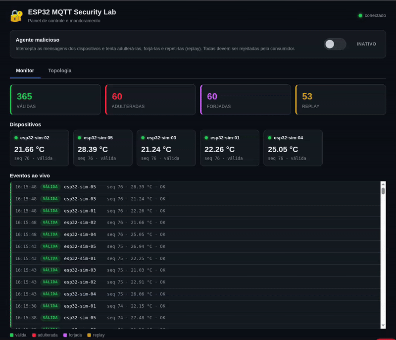

# ESP32 + MQTT + TLS + HMAC-SHA256

Laboratório de segurança para publicação de telemetria de um ESP32 via MQTT,
com três camadas independentes de proteção. Material extra do
[Módulo 2](../../README.md), apresentado em uma monitoria do curso; os slides
de apoio estão em [slides_monitoria.pdf](slides_monitoria.pdf).

Esta pasta reúne a parte essencial do projeto
[esp32-mqtt-security-lab](https://github.com/JunioCesarFerreira/esp32-mqtt-security-lab).
Lá também estão uma variante do firmware com display OLED SSD1306 e um script
`flash.sh` para compilar e gravar o firmware pelo terminal (`arduino-cli`).

## 1. Arquitetura

O ESP32 publica pela rede Wi-Fi para um broker Mosquitto rodando em Docker.
Os serviços `broker`, `subscriber`, `device-simulator`, `attacker` e
`dashboard` compartilham uma rede Docker privada (`mqttnet`); a porta MQTT/TLS
(`8883`) do broker é exposta à rede local (para o ESP32 alcançar) e a porta
HTTP do painel (`8080` por padrão) é exposta para o navegador.

Um serviço `dashboard` oferece uma interface web (http://localhost:8080) para
acompanhar todas as mensagens em tempo real e controlar o laboratório — por
exemplo, ligar e desligar o `attacker` com um clique.

Além do ESP32 físico, um serviço `device-simulator` publica dados de N
dispositivos simulados (cada um em sua própria thread, assinando os dados do
mesmo jeito que o firmware real), útil para testar o `subscriber` e o broker
sob carga sem depender de hardware.

Um serviço `attacker` simula um cliente comprometido com credenciais MQTT
válidas: intercepta as mensagens de todos os outros publishers e tenta
reenviá-las adulteradas, forjadas e repetidas (replay) ao `subscriber`, para
demonstrar na prática que TLS + usuário/senha + ACL, por si só, não bastam
sem o HMAC (e sem controle de sequência contra replay).

Três camadas de segurança, independentes entre si:

- **TLS** (porta `8883`): criptografia do transporte.
- **Usuário e senha MQTT**: autenticação de acesso ao broker (via ACL, cada
  cliente só pode publicar ou assinar os tópicos que lhe cabem).
- **HMAC-SHA256**: autenticidade e integridade dos dados de ponta a ponta,
  do ESP32 até o consumidor Python. O broker MQTT **não** conhece essa
  chave — ele apenas transporta bytes.

## 2. Estrutura da pasta

```
compose.yaml                  # broker + subscriber + device-simulator + attacker + dashboard
setup.sh                      # gera certificados, credenciais e chave HMAC
slides_monitoria.pdf          # slides de apoio da monitoria
hmac.gif                      # demonstração do painel e dos ataques simulados
.env                           # UID/GID, SIM_DEVICE_COUNT, DASHBOARD_PORT (gerado, não versionado)
mosquitto/
  config/mosquitto.conf       # listener TLS, auth, ACL
  config/acl.conf             # permissões por usuário MQTT
  config/passwd               # gerado por setup.sh (não versionado)
  certs/                      # CA e certificado do broker (gerados, não versionados)
  data/, log/                 # persistência e logs do Mosquitto
subscriber/
  Dockerfile, requirements.txt
  subscriber.py                # valida HMAC, bloqueia replay e mostra teste de adulteração
  .env                          # gerado por setup.sh (não versionado)
simulator/
  Dockerfile, requirements.txt
  simulator.py                  # N dispositivos simulados, 1 thread por dispositivo
  .env                           # gerado por setup.sh (não versionado)
attacker/
  Dockerfile, requirements.txt
  attacker.py                   # intercepta e tenta tamper/forjar/repetir mensagens
  .env                           # gerado por setup.sh (não versionado, sem a chave HMAC real)
dashboard/
  Dockerfile, requirements.txt
  app.py                         # backend Flask: monitora via MQTT, stream SSE, controla o atacante
  index.html                     # painel web (feed ao vivo, estatísticas, toggle do atacante)
  .env                           # gerado por setup.sh (não versionado)
esp32/
  esp32.ino                    # firmware (WiFi + TLS + HMAC-SHA256 via mbedtls)
  secrets.h.example             # modelo de referência
  secrets.h, ca_cert.h          # gerados por setup.sh (não versionados)
```

## 3. Como executar

Descubra o IP do computador que vai executar o Docker (o ESP32 precisa
alcançar esse IP pela rede Wi-Fi):

```bash
hostname -I
```

Supondo `192.168.1.50`, a partir da raiz do repositório do curso:

```bash
cd M2/Extras/Hands_On_HMAC_MQTT
./setup.sh 192.168.1.50
```

Todos os comandos a seguir (`docker compose ...`) também são executados
dentro desta pasta.

> O `setup.sh` usa `openssl` e Docker (para gerar o arquivo de senhas com a
> imagem do Mosquitto). Em cada execução, ele **regenera** todos os
> certificados, senhas e a chave HMAC — depois de rodá-lo de novo, grave o
> firmware outra vez e reinicie os containers.

O script gera:

- CA própria e certificado TLS do broker com SAN para esse IP;
- cinco usuários MQTT (`esp32-01` e `simulator` para publicar,
  `subscriber` para assinar, `dashboard` para monitorar/controlar, e
  `attacker` com ACL deliberadamente ampla para o laboratório de ataque),
  com senhas aleatórias;
- uma chave HMAC-SHA256 aleatória (32 bytes), compartilhada entre o firmware
  do ESP32 (`esp32/secrets.h`), o simulador (`simulator/.env`), o consumidor
  (`subscriber/.env`) e o painel (`dashboard/.env`) — o broker e o `attacker`
  nunca a recebem.

Edite o SSID e a senha do Wi-Fi em `esp32/secrets.h` (gerado pelo script).

Suba os containers:

```bash
docker compose up -d --build
```

> Este laboratório usa a porta `8883` e o nome de container `mqtt-broker`,
> os mesmos do broker da [Aula 8](../../Aula_8_pipeline_iot/README.md).
> Pare a stack da Aula 8 (`docker compose down` na pasta dela) antes de subir
> esta.

Abra o painel no navegador: **http://localhost:8080**. Ele mostra as mensagens
em tempo real e tem um botão para ligar/desligar o atacante (veja a seção 5).

No Arduino IDE, abra `esp32/esp32.ino`, instale a biblioteca `PubSubClient`,
selecione sua placa ESP32 e grave o firmware. Sem a placa física, o
`device-simulator` (seção 4) já publica dados assinados e permite fazer todo o
laboratório.

Para acompanhar as mensagens validadas também pelo terminal:

```bash
docker compose logs -f subscriber
```

Saída esperada:

```
[VALIDA] device=esp32-01 seq=1
temperatura=25.00 C

TESTE: temperatura adulterada (+1 C):
REJEITADA
```

O firmware inicialmente gera temperaturas simuladas, sem depender de sensor
físico. Depois, basta substituir `readSimulatedTemperature()` pela leitura
de um DHT22, DS18B20 ou outro sensor real.

## 4. Simulador de dispositivos

O serviço `device-simulator` sobe junto com `docker compose up` e cria N
"ESP32 virtuais" (`esp32-sim-01`, `esp32-sim-02`, ...), cada um em sua própria
thread, publicando em `sensors/sim/<device>/data` com a mesma assinatura
HMAC-SHA256 do firmware real. O broker tem uma ACL própria para o usuário
`simulator`, restrita a esse namespace (`sensors/sim/+/data`).

N é controlado pela variável de ambiente `SIM_DEVICE_COUNT` (padrão: `5`,
definido em `.env` pelo `setup.sh`). Para mudar o número de dispositivos:

```bash
# editando o .env desta pasta
SIM_DEVICE_COUNT=20

# ou sobrescrevendo na hora de subir os containers
SIM_DEVICE_COUNT=20 docker compose up -d
```

## 5. Agente malicioso (`attacker`)

O serviço `attacker` simula um cliente que já comprometeu um dispositivo com
credenciais MQTT válidas e uma ACL ampla (`sensors/#`, leitura e escrita —
veja `mosquitto/config/acl.conf`). Ele **começa inativo** e só ataca quando
ligado pelo painel (seção 6), que publica no tópico de controle
`control/attacker`. Quando ativo, intercepta todas as mensagens publicadas
por `esp32-01` e pelo `device-simulator` e, para cada uma, tenta três ataques,
publicando de volta no mesmo tópico da vítima:

1. **Adulteração (tamper)** — altera a temperatura mas mantém o HMAC
   original, que não corresponde mais ao novo conteúdo.
2. **Forjar leitura** — cria uma leitura inteiramente falsa para o mesmo
   dispositivo, assinada com uma chave HMAC própria e aleatória (o atacante
   nunca recebe a chave real — veja `attacker/.env`).
3. **Replay** — reenvia, sem nenhuma alteração, o payload original já
   capturado (HMAC válido, porque é bit a bit idêntico ao original).

Os dois primeiros ataques são sempre rejeitados pela verificação de HMAC do
`subscriber.py`. O terceiro **não seria pego pelo HMAC isoladamente** — por
isso o `subscriber.py` também guarda o maior número de sequência (`seq`) já
aceito por dispositivo e rejeita qualquer `seq` repetido ou menor:

```
[REJEITADA] device=esp32-sim-01 seq=2 - HMAC invalido              <- tamper
[REJEITADA] device=esp32-sim-01 seq=1000002 - HMAC invalido        <- forjado
[REJEITADA] device=esp32-sim-01 seq=2 - replay ou fora de ordem (ultimo aceito: 2)  <- replay
[VALIDA] device=esp32-sim-01 seq=3
```

A ACL do usuário `attacker` é intencionalmente permissiva — representa o
pior caso (cliente totalmente comprometido) para provar que a defesa real
está na camada de aplicação (HMAC + sequência), não apenas no broker. Nunca
reproduza essa ACL fora deste laboratório.

## 6. Painel web (`dashboard`)

Abra **http://localhost:8080** depois de subir os containers. O painel é um
container próprio (`dashboard`) com backend Flask + MQTT e um frontend web,
pensado para ser visual e fácil de usar. O botão de ligar/desligar o atacante
fica sempre visível no topo, e o conteúdo é dividido em duas abas.

**Aba Monitor:**

- **Toggle do atacante** — um botão liga/desliga o agente malicioso em tempo
  real. Quando ativo, aparece um alerta vermelho no topo (`ATACANTE ATIVO`).
- **Estatísticas** — contadores de mensagens válidas, adulteradas, forjadas e
  de replay.
- **Dispositivos** — um cartão por dispositivo com a última temperatura, o
  último `seq` e um indicador verde/vermelho do último veredito.
- **Eventos ao vivo** — uma lista rolante, colorida por tipo, mostrando cada
  mensagem recebida e o motivo de aceitação ou rejeição.

**Aba Topologia:**

Um diagrama SVG animado da rede simulada. Os dispositivos aparecem à esquerda,
o broker ao centro e o subscriber/dashboard à direita; o atacante fica embaixo
e acende em vermelho quando ativo. A cada mensagem recebida, um pacote viaja
pela topologia: **verde** para telemetria válida (dispositivo → broker →
subscriber) e **vermelho/roxo/laranja** para os ataques injetados pelo atacante
(atacante → broker), que terminam em um flash vermelho de rejeição no
subscriber. Ligue o atacante e troque para esta aba para ver os ataques sendo
barrados em tempo real.

O GIF abaixo mostra as abas **Monitor** e **Topologia**, com o atacante sendo
ligado e desligado. Observe a telemetria válida, a rejeição de mensagens
adulteradas e forjadas pela validação de HMAC e o bloqueio de replay pelo
controle de sequência.



Como funciona por baixo: o backend assina MQTT (`sensors/#`), refaz a mesma
validação HMAC + sequência do `subscriber` e transmite cada veredito ao
navegador via **SSE** (Server-Sent Events). O botão do atacante faz um
`POST /api/attacker`, que publica `{"active": true|false}` (retido) em
`control/attacker`; o `attacker` reage e publica seu estado em
`control/attacker/status`, que o painel lê de volta para manter o botão
sincronizado — inclusive após recarregar a página ou reiniciar um container.

A porta do host é configurável pela variável `DASHBOARD_PORT` no `.env`
desta pasta (padrão `8080`). Se a `8080` já estiver em uso, troque o valor:

```bash
# no .env desta pasta
DASHBOARD_PORT=8088

# ou na hora de subir
DASHBOARD_PORT=8088 docker compose up -d
```

## 7. Cuidados com a rede

- O ESP32 deve acessar o **IP** do computador que hospeda o Docker — nunca
  `localhost` nem o IP interno de um container. A rede Wi-Fi precisa permitir
  essa comunicação, e a porta TCP `8883` precisa estar acessível a partir do
  ESP32.
- O certificado TLS do broker é emitido especificamente para o IP informado
  ao `setup.sh`. Se esse IP mudar, rode `setup.sh` novamente.
- O firmware carrega a CA correspondente (`esp32/ca_cert.h`) e valida o
  certificado do broker — a validação criptográfica não é desabilitada.

## 8. Modelo de assinatura HMAC

O ESP32 assina a string `"<device>|<seq>|<temperatura>"` (temperatura já
formatada com duas casas decimais) usando HMAC-SHA256 com a chave
compartilhada, e publica:

```json
{"device": "esp32-01", "seq": 1, "temp": "25.00", "hmac": "<hex>"}
```

O `subscriber.py` recalcula o mesmo HMAC a partir dos campos recebidos e
compara com `hmac.compare_digest`. Qualquer alteração em `device`, `seq` ou
`temp` — mesmo pelo próprio broker ou por um atacante na rede — invalida a
assinatura e a mensagem é marcada como `REJEITADA`.

[Voltar ao Módulo 2](../../README.md)
