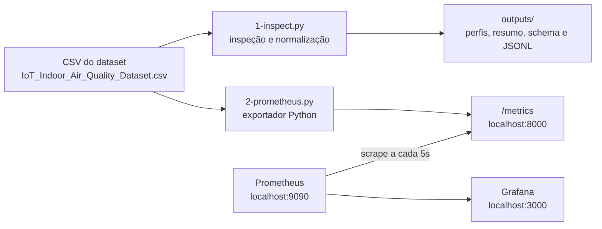

# Prática 1 - Datasets

Esta aula usa um dataset de qualidade do ar em ambientes internos para praticar inspeção de dados, normalização de eventos IoT e exposição de métricas Prometheus. Toda a prática roda localmente com Docker.

## 1. Objetivo da prática

Ao final da prática, você deve conseguir:

- inspecionar um dataset IoT real antes de integrá-lo a qualquer ferramenta: identificar medições, metadados, tipos e unidades;
- normalizar leituras de sensores em eventos IoT com um schema mínimo;
- explicar o papel de um **exportador Prometheus** e o modelo de coleta por *scrape*;
- subir com Docker Compose a cadeia exportador → Prometheus → Grafana e consultar as métricas com PromQL.

## 2. Conceitos da prática

### Análise por inspeção

A inspeção é a primeira etapa: entender o dataset antes de integrá-lo a uma ferramenta de observabilidade. O script [`scripts/1-inspect.py`](scripts/1-inspect.py) faz uma leitura exploratória de `data/IoT_Indoor_Air_Quality_Dataset.csv` sem modificar o CSV original:

- normaliza os nomes das colunas para nomes fáceis de usar em código;
- identifica colunas numéricas que representam medições de sensores;
- classifica colunas em categorias semânticas (`measurement`, `metadata`, `event`, `state`, `command`);
- calcula estatísticas descritivas das colunas numéricas;
- gera um schema mínimo para eventos IoT;
- transforma parte das leituras em eventos normalizados no formato JSONL.

Os arquivos gerados em `outputs/` são a evidência da inspeção (a pasta `outputs_example/` traz uma execução de referência):

| Arquivo | Conteúdo |
| --- | --- |
| `columns_profile.csv` | perfil técnico das colunas: tipo, nulos, valores únicos, exemplos |
| `semantic_classification.csv` | classificação semântica das colunas |
| `numeric_summary.csv` | resumo estatístico das medições numéricas |
| `normalized_events.jsonl` | eventos IoT normalizados a partir das leituras |
| `iot_event_schema.json` | schema mínimo de evento IoT |
| `inspection_summary.json` | resumo da execução |

Essa etapa responde perguntas como: quais colunas são medições? quais são metadados? quais dados podem virar métricas?

### Exportador Prometheus

O Prometheus não lê CSV: ele **coleta** (*scrape*) métricas de um endpoint HTTP `/metrics` em intervalos regulares. O script [`scripts/2-prometheus.py`](scripts/2-prometheus.py) usa o CSV como fonte de uma simulação de sensores: lê uma linha a cada 5 segundos, extrai as colunas numéricas e publica os valores como métricas `Gauge`, além de uma flag simples de anomalia baseada em média e desvio padrão.



Principais métricas publicadas:

- `opaiot_iaq_sensor_value`: valor atual simulado de cada medição do dataset;
- `opaiot_iaq_anomaly_flag`: indica anomalia simples quando o valor se afasta muito da média;
- `opaiot_iaq_stream_index`: linha atual do CSV sendo simulada;
- `opaiot_iaq_dataset_rows`: quantidade total de linhas carregadas;
- `opaiot_iaq_active_metrics`: quantidade de colunas numéricas exportadas.

### Estrutura da aula

- `data/`: CSV usado na aula e a referência da fonte do dataset ([data/README.md](data/README.md));
- `scripts/`: scripts Python e `requirements.txt` ([scripts/README.md](scripts/README.md) explica como executá-los fora do Docker);
- `outputs/`: recebe os arquivos gerados pela inspeção;
- `outputs_example/`: execução de exemplo versionada para consulta;
- `docker/`: Compose que sobe exportador, Prometheus e Grafana ([docker/README.md](docker/README.md)).

## 3. Prática passo a passo

Pré-requisitos: Docker com Docker Compose v2 e Git.

### 3.1. Obter os arquivos

```bash
git clone https://github.com/opaiot/ia-otimizacao-iot-industrias-negocios-public.git
cd ia-otimizacao-iot-industrias-negocios-public/M3/Aula_1_datasets/docker
```

### 3.2. Subir a stack

```bash
docker compose up --build -d
```

A primeira execução constrói a imagem Python e baixa Prometheus e Grafana. Verifique:

```bash
docker compose ps
```

Os serviços `exporter`, `prometheus` e `grafana` devem aparecer como `running`.

### 3.3. Executar a inspeção do dataset

O serviço `inspect` roda o `1-inspect.py` uma vez e grava os resultados em `../outputs/` no host:

```bash
docker compose --profile inspect run --rm inspect
```

Confira os arquivos gerados e compare com `outputs_example/`:

```bash
ls ../outputs
```

Abra `columns_profile.csv` e `semantic_classification.csv` e identifique: quais colunas foram classificadas como `measurement`? Alguma coluna ficou com classificação que você discorda?

### 3.4. Ver as métricas do exportador

```bash
curl http://localhost:8000/metrics
```

Procure as métricas `opaiot_iaq_*`. Repita o comando após alguns segundos e observe `opaiot_iaq_stream_index` avançando: o exportador publica uma linha do CSV a cada 5 segundos.

### 3.5. Consultar no Prometheus

Abra <http://localhost:9090>:

- em **Status > Targets**, o job `opaiot_iaq` deve estar `UP`;
- em **Graph**, execute as consultas:

```promql
opaiot_iaq_sensor_value
opaiot_iaq_anomaly_flag
opaiot_iaq_dataset_rows
```

Alterne para a aba *Graph* e observe as séries temporais se formando a partir das coletas.

### 3.6. Ver o dashboard no Grafana

Abra <http://localhost:3000> (usuário `admin`, senha `admin`). O datasource `Prometheus - IAQ` e o dashboard `OpAIoT - IAQ Datasets` já vêm provisionados:

```text
http://localhost:3000/d/opaiot-iaq
```

Observe os painéis se atualizando conforme o exportador avança pelo CSV.

### 3.7. Encerrar

```bash
docker compose down        # para os containers
docker compose down -v     # para e remove também os volumes (Prometheus, Grafana)
```

### Problemas comuns

- Porta `8000`, `9090` ou `3000` ocupada: pare o que estiver usando a porta (outra prática do módulo, por exemplo) ou ajuste o mapeamento no [docker/docker-compose.yml](docker/docker-compose.yml).
- Job `opaiot_iaq` como `DOWN` no Prometheus: veja os logs do exportador com `docker compose logs exporter`.
- Para executar os scripts com Python direto na sua máquina, sem Docker, veja [scripts/README.md](scripts/README.md).

## 4. Sugestão de exercícios sobre a prática

1. **Classificação semântica.** Abra `outputs/semantic_classification.csv` e justifique a classificação de três colunas. Há alguma coluna de `metadata` que poderia virar um *label* de métrica em vez de uma métrica própria?
2. **Intervalo de publicação.** Altere `INTERVAL_SECONDS` para `1.0` no topo de `scripts/2-prometheus.py`, rode `docker compose up --build -d` de novo e observe no Prometheus o efeito em `rate(opaiot_iaq_stream_index[1m])`. O `scrape_interval` de 5s do Prometheus continua adequado?
3. **Anomalias.** No Prometheus, execute `opaiot_iaq_anomaly_flag == 1` e identifique quais medições disparam a flag. Olhe o cálculo no `2-prometheus.py`: que limitação essa detecção por média e desvio padrão tem para séries com tendência?
4. **Novo painel.** No Grafana, adicione ao dashboard um painel *timeseries* com `opaiot_iaq_sensor_value{metric="temperature_c"}` (os valores possíveis do label `metric` aparecem na página `/metrics` do exportador).
5. **Desafio.** Edite `1-inspect.py` para gravar também um `outputs/rooms_summary.csv` com estatísticas por sala (se o dataset tiver essa coluna) e rode a inspeção de novo pelo serviço `inspect`.
