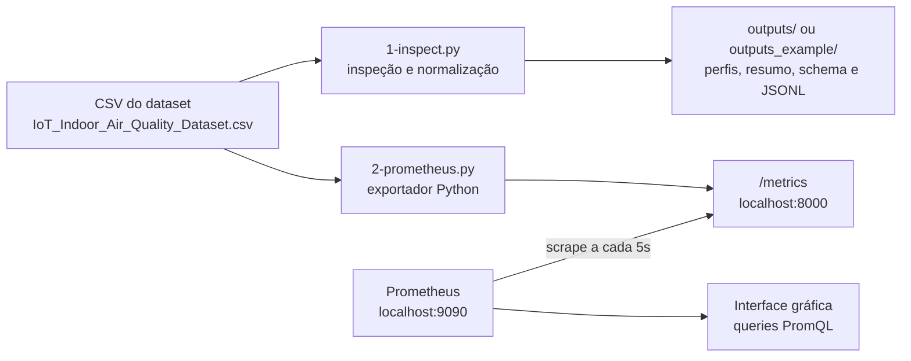

# Prática 1 - Datasets

Esta aula usa um dataset de qualidade do ar em ambientes internos para praticar inspeção de dados, normalização de eventos IoT e exposição de métricas Prometheus.

| Ambiente | Quando usar | Entrada |
| --- | --- | --- |
| VM do curso | Caminho principal da prática. A VM é um container Ubuntu em que o Prometheus já está instalado e em execução (sem Docker e sem systemd). Veja o [guia do ambiente da VM](../ambiente_vm.md). | Seções 1 a 7 deste README |
| Docker local (opcional) | Somente para quem quiser executar a prática na própria máquina, fora da VM disponibilizada. Não faz parte do roteiro da aula. | [Opcional: execução local com Docker](#opcional-execução-local-com-docker) |

## Estrutura

- `data/`: contém o CSV usado na aula e a referência da fonte do dataset.
- `scripts/`: contém os scripts Python e o `requirements.txt`.
- `outputs/`: recebe os arquivos gerados localmente pelo script de inspeção.
- `outputs_example/`: contém uma execução de exemplo versionada para consulta.
- `docker/`: opcional, não usado na VM. Sobe exportador, Prometheus e Grafana em containers para quem quiser executar localmente. Veja [docker/README.md](docker/README.md).

Scripts principais:

- `scripts/1-inspect.py`: lê o CSV, normaliza nomes de colunas, gera perfis, resumo numérico, eventos JSONL e schema.
- `scripts/2-prometheus.py`: lê o CSV e expõe leituras simuladas como métricas Prometheus em `/metrics`.

## Análise por inspeção

A análise por inspeção é a primeira etapa da prática. O objetivo é entender o dataset antes de integrá-lo a uma ferramenta de observabilidade.

O script `scripts/1-inspect.py` faz uma leitura exploratória do arquivo `data/IoT_Indoor_Air_Quality_Dataset.csv` sem modificar o CSV original. Durante a execução, ele:

- normaliza os nomes das colunas para nomes mais fáceis de usar em código;
- identifica colunas numéricas que representam medições de sensores;
- classifica colunas em categorias semânticas, como `measurement`, `metadata`, `event`, `state` e `command`;
- calcula estatísticas descritivas das colunas numéricas;
- gera um schema mínimo para eventos IoT;
- transforma parte das leituras em eventos normalizados no formato JSONL.

Os arquivos gerados em `outputs/` servem como evidência da inspeção. A pasta `outputs_example/` guarda uma amostra desses resultados para consulta sem precisar executar o script.

- `columns_profile.csv`: perfil técnico das colunas, incluindo tipo, valores nulos, valores únicos e exemplos.
- `semantic_classification.csv`: classificação semântica das colunas.
- `numeric_summary.csv`: resumo estatístico das medições numéricas.
- `normalized_events.jsonl`: eventos IoT normalizados a partir das leituras do CSV.
- `iot_event_schema.json`: schema mínimo usado para representar eventos IoT.
- `inspection_summary.json`: resumo da execução do script.

Essa etapa ajuda a responder perguntas como: quais colunas são medições? quais são metadados? quais unidades aparecem? quais dados podem virar métricas?

## Integração dos dados no Prometheus

Depois da inspeção, o script `scripts/2-prometheus.py` usa o CSV como fonte de uma simulação de sensores. Ele lê uma linha por vez, extrai as colunas numéricas e publica os valores como métricas no formato esperado pelo Prometheus.

O script funciona como um exportador Prometheus:

- lê o CSV;
- normaliza os nomes das colunas;
- identifica medições numéricas;
- cria métricas `Gauge`;
- publica as métricas em `http://localhost:8000/metrics`;
- atualiza os valores a cada 5 segundos;
- calcula uma flag simples de anomalia com base em média e desvio padrão.

O Prometheus não lê o CSV diretamente. Ele coleta as métricas expostas pelo script Python. Por isso há dois serviços diferentes:

- Prometheus: interface e banco de séries temporais em `http://localhost:9090`;
- Exportador Python: endpoint de métricas em `http://localhost:8000/metrics`.

Fluxo da integração:



Principais métricas publicadas:

- `opaiot_iaq_sensor_value`: valor atual simulado de cada medição do dataset.
- `opaiot_iaq_anomaly_flag`: indica anomalia simples quando o valor se afasta muito da média.
- `opaiot_iaq_stream_index`: linha atual do CSV sendo simulada.
- `opaiot_iaq_dataset_rows`: quantidade total de linhas carregadas.
- `opaiot_iaq_active_metrics`: quantidade de colunas numéricas exportadas.

## 1. Acessar a VM Linux pelo Windows

No Windows, abra o PowerShell e confirme que o cliente SSH está disponível:

```powershell
ssh -V
```

Defina o usuário e a porta (recebidos por e-mail do curso; a porta é diferente para cada aluno) e o endereço da VM:

```powershell
$VM_USER = "opaiotNNN"      # usuário do e-mail
$VM_HOST = "andromeda.lasdpc.icmc.usp.br"
$VM_PORT = "PORTA"          # porta do e-mail
```

Acesse a VM e informe a senha recebida por e-mail:

```powershell
ssh -p $VM_PORT "${VM_USER}@${VM_HOST}"
```

> O acesso é só por **login interativo**: `ssh ... comando`, `scp`, `sftp` e túnel de portas (`ssh -L`) são bloqueados nesta VM. Por isso este roteiro não usa nenhum deles. Detalhes e outros limites do ambiente estão no [guia da VM](../ambiente_vm.md).

## 2. Clonar o repositório na VM

Os pacotes básicos (`git`, `python3`, `pip`, `venv` e `curl`) já vêm instalados na VM. Se algum faltar, instale-o com `sudo apt update` e `sudo apt install -y <pacote>`.

Clone o repositório dentro de `~/workspace`, a pasta preservada pelo ambiente:

```bash
cd ~/workspace
git clone https://github.com/opaiot/ia-otimizacao-iot-industrias-negocios-public.git
cd ia-otimizacao-iot-industrias-negocios-public/M3/Aula_1_datasets
```

## 3. Preparar o ambiente Python

Entre na pasta de scripts:

```bash
cd ~/workspace/ia-otimizacao-iot-industrias-negocios-public/M3/Aula_1_datasets/scripts
```

Crie e ative um ambiente virtual:

```bash
python3 -m venv .venv
source .venv/bin/activate
```

Instale as dependências:

```bash
python -m pip install --upgrade pip
python -m pip install -r requirements.txt
```

## 4. Executar o script de inspeção

Execute:

```bash
python 1-inspect.py
```

Os arquivos serão gerados em:

```text
~/workspace/ia-otimizacao-iot-industrias-negocios-public/M3/Aula_1_datasets/outputs/
```

Se você ainda não executou o script, consulte `outputs_example/` para ver uma amostra dos arquivos esperados.

Confira o resultado:

```bash
ls -lah ../outputs
```

Arquivos esperados:

- `columns_profile.csv`
- `semantic_classification.csv`
- `numeric_summary.csv`
- `normalized_events.jsonl`
- `iot_event_schema.json`
- `inspection_summary.json`

## 5. Executar o exportador Prometheus

Execute:

```bash
python 2-prometheus.py
```

O script fica em execução contínua e expõe métricas em:

```text
http://localhost:8000/metrics
```

O intervalo atual de publicação do script é de 5 segundos:

```python
INTERVAL_SECONDS = 5.0
```

Como o exportador ocupa o terminal, abra uma **segunda sessão SSH** na VM (outra janela do PowerShell) para testar:

```bash
curl http://localhost:8000/metrics | head
```

Para encerrar o exportador, volte ao primeiro terminal e pressione `Ctrl+C`.

> Se preferir uma única sessão, inicie o exportador em segundo plano com `nohup python 2-prometheus.py > exportador.log 2>&1 &` e encerre-o antes de sair com `pkill -f 2-prometheus.py`.

### Configurar o Prometheus da VM

Na VM do curso, o Prometheus **já está instalado e em execução**: o próprio ambiente o iniciou, como `root`, sem Docker e sem `systemd`. Ele acessa o exportador Python pelo target `localhost:8000`.

Edite o arquivo de configuração:

```bash
sudo nano /etc/prometheus/prometheus.yml
```

Na VM, o arquivo traz apenas o job `prometheus` (o próprio Prometheus). Acrescente o job da aula **dentro de `scrape_configs`**, com a mesma indentação, de modo que o arquivo fique assim:

```yaml
global:
  scrape_interval: 5s

scrape_configs:
  - job_name: "prometheus"
    static_configs:
      - targets: ["localhost:9090"]

  - job_name: "opaiot_iaq"
    scrape_interval: 5s
    static_configs:
      - targets: ["localhost:8000"]
```

Salve com `Ctrl+O` e `Enter` e saia do `nano` com `Ctrl+X`. Valide a configuração:

```bash
promtool check config /etc/prometheus/prometheus.yml
```

Recarregue a configuração **sem reiniciar** o Prometheus, enviando o sinal `SIGHUP` ao processo:

```bash
sudo pkill -HUP -x prometheus
```

> **Para incluir um job, recarregar basta; reiniciar não é necessário.** O processo do Prometheus pertence ao `root`, então `pkill` e o comando de inicialização precisam de `sudo`: sem ele, o `pkill` responde `Operation not permitted` e um novo Prometheus falha com `permission denied`. Se mesmo assim precisar reiniciá-lo, use `sudo` e siga a [seção 4.3 do guia da VM](../ambiente_vm.md#43-reiniciar-o-prometheus-ou-o-grafana-quando-for-realmente-necessário). Cuidado com `pkill -f prometheus`: ele também encerra o seu `2-prometheus.py`, porque o nome do arquivo contém "prometheus"; prefira `pkill -x prometheus`.

Com o `2-prometheus.py` rodando em outra sessão, aguarde cerca de 10 segundos e confira:

```bash
curl http://localhost:9090/-/healthy
curl -s http://localhost:9090/api/v1/targets | jq -r '.data.activeTargets[] | "\(.labels.job)\t\(.scrapeUrl)\t\(.health)"'
```

O job `opaiot_iaq` deve aparecer com `up`. Você também pode ver o estado dos jobs no navegador, em `http://andromeda.lasdpc.icmc.usp.br:19XXX/targets` (`XXX` = os três dígitos do seu usuário `opaiotXXX`). Consulte uma das métricas pela API do Prometheus:

```bash
curl -s 'http://localhost:9090/api/v1/query?query=opaiot_iaq_dataset_rows' | jq -c '.data.result'
```

### Ver as métricas no navegador

A interface do Prometheus abre no navegador do seu computador em `http://andromeda.lasdpc.icmc.usp.br:19XXX`, trocando `XXX` pelos três dígitos do seu usuário `opaiotXXX` (por exemplo, `opaiot001` usa a porta `19001`). Abra `/targets` para ver o job `opaiot_iaq` como `UP` e `/graph` para executar `opaiot_iaq_sensor_value`.

O endereço do exportador, `http://localhost:8000/metrics`, não tem acesso externo (o túnel SSH `ssh -L` também está bloqueado): consulte-o de dentro da VM, com `curl`, como acima. Mais detalhes na [seção 5 do guia da VM](../ambiente_vm.md#5-interface-web-do-prometheus-e-do-grafana). Quem quiser rodar tudo na própria máquina pode usar a [alternativa local com Docker](#opcional-execução-local-com-docker).

## 6. Ver e copiar os outputs da VM

Os arquivos de `outputs/` são pequenos e podem ser lidos direto na VM:

```bash
cd ~/workspace/ia-otimizacao-iot-industrias-negocios-public/M3/Aula_1_datasets/outputs
cat inspection_summary.json
cat columns_profile.csv
head -n 3 normalized_events.jsonl
```

O `scp` não funciona nesta VM. Para levar os arquivos para o seu computador, copie o conteúdo pelo terminal conforme a [seção 7 do guia da VM](../ambiente_vm.md#7-copiar-arquivos-pequenos-para-o-seu-computador) (a pasta `outputs/` compactada e codificada ocupa cerca de 11 KB). A pasta [`outputs_example/`](outputs_example/) do repositório traz uma execução de referência para comparar.

## 7. Problemas comuns

Se aparecer `ModuleNotFoundError`, ative o ambiente virtual e reinstale as dependências:

```bash
source .venv/bin/activate
python -m pip install -r requirements.txt
```

Se a porta `8000` estiver ocupada, edite a constante `PORT` no topo de `scripts/2-prometheus.py`.

Se o job `opaiot_iaq` aparecer como `down` em `/api/v1/targets`, confirme que o `2-prometheus.py` está em execução e que `curl http://localhost:8000/metrics` responde. Depois de corrigir, não é preciso recarregar o Prometheus de novo.

Se o `pkill` responder `Operation not permitted` ou o Prometheus falhar com `permission denied`, faltou `sudo` (o processo é do `root`). Para recarregar a configuração, use `sudo pkill -HUP -x prometheus`, como na seção 5; para reiniciar de verdade, veja a [seção 4.3 do guia da VM](../ambiente_vm.md#43-reiniciar-o-prometheus-ou-o-grafana-quando-for-realmente-necessário).

Execute os scripts como arquivos:

```bash
python 1-inspect.py
python 2-prometheus.py
```

Não use `python -m` com esses nomes, pois `1-inspect.py` e `2-prometheus.py` são nomes de arquivo, não nomes de módulo Python.

## Opcional: execução local com Docker

> **Esta seção não faz parte da prática.** O roteiro da aula é executado na VM disponibilizada, seguindo as seções 1 a 7, e a VM não usa Docker. Use as instruções abaixo somente se quiser reproduzir a prática na sua própria máquina, com Docker instalado.

### Stack completa em containers

A forma mais simples de executar localmente é a pasta [`docker/`](docker/README.md), que sobe o exportador Python, o Prometheus e o Grafana em containers, já configurados:

```bash
cd M3/Aula_1_datasets/docker
docker compose up --build
```

Endpoints, dashboard provisionado e geração dos outputs estão descritos em [docker/README.md](docker/README.md).

### Script Python no host e Prometheus em container

Se preferir executar o `2-prometheus.py` diretamente na sua máquina e apenas o Prometheus em um container, cuidado com `localhost`: dentro do container, `localhost` aponta para o próprio container, não para a sua máquina.

Nesse caso, o script Python continua expondo as métricas na sua máquina em:

```text
http://localhost:8000/metrics
```

Mas o `prometheus.yml` do container deve apontar para o host Docker. No Linux, uma forma prática é usar `host.docker.internal` com o mapeamento `host-gateway`.

Exemplo de `prometheus.yml`:

```yaml
scrape_configs:
  - job_name: "opaiot_iaq"
    scrape_interval: 5s
    static_configs:
      - targets: ["host.docker.internal:8000"]
```

Se o container foi iniciado com `docker run`, inclua:

```bash
--add-host=host.docker.internal:host-gateway
```

Exemplo:

```bash
docker run -d \
  --name prometheus \
  -p 9090:9090 \
  --add-host=host.docker.internal:host-gateway \
  -v "$PWD/prometheus.yml:/etc/prometheus/prometheus.yml" \
  prom/prometheus
```

Se estiver usando `docker compose`, inclua no serviço do Prometheus:

```yaml
extra_hosts:
  - "host.docker.internal:host-gateway"
```

Depois reinicie o container:

```bash
docker compose restart prometheus
```

Para testar se o container alcança o exportador Python:

```bash
docker exec prometheus wget -qO- http://host.docker.internal:8000/metrics | head
```

Se o nome do container não for `prometheus`, descubra com:

```bash
docker ps
```

Alternativa no Linux: usar o IP da bridge Docker do host no `prometheus.yml`:

```bash
ip -4 addr show docker0
```

Normalmente será algo como `172.17.0.1`; nesse caso, o target ficaria:

```yaml
targets: ["172.17.0.1:8000"]
```
