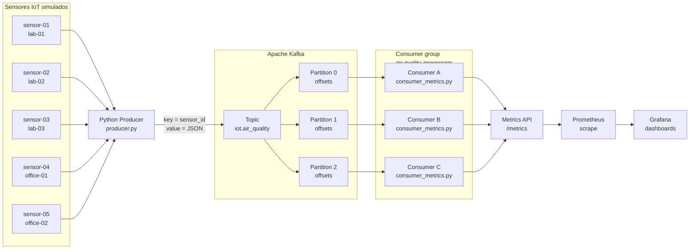

# Prática 3 - Apache Kafka para telemetria IoT observável

Esta aula apresenta o Apache Kafka como infraestrutura para pipelines orientados a eventos em IoT. O cenário simula sensores ambientais enviando medições para um tópico Kafka, consumidores processando esses eventos e métricas sendo expostas para Prometheus e Grafana. Toda a prática roda localmente com Docker.

## 1. Objetivo da prática

Ao final da prática, você deve conseguir:

- explicar os conceitos centrais do Kafka: tópico, partition, offset, chave, consumer group e lag;
- demonstrar que eventos com a mesma chave (`sensor_id`) caem na mesma partition, preservando a ordem por sensor;
- observar o rebalanceamento quando consumers entram ou saem de um grupo;
- mostrar que grupos diferentes leem o mesmo tópico de forma independente e que um consumer retoma do offset salvo;
- acompanhar o pipeline por métricas no Prometheus e em um dashboard do Grafana.

## 2. Conceitos da prática

Kafka não deve ser entendido apenas como uma fila de mensagens. Nesta prática, ele aparece como um **log distribuído de eventos**, em que producers publicam eventos em tópicos, tópicos são divididos em partitions e consumers leem esses eventos mantendo offsets.

- **Producer**: aplicação que publica eventos no Kafka. Aqui, o script [`scripts/producer.py`](scripts/producer.py), que simula 5 sensores.
- **Event**: uma medição IoT enviada como mensagem: sensor, sala, temperatura, umidade, CO2 e timestamp.
- **Topic**: canal lógico onde os eventos são publicados. A prática usa `iot.air_quality`.
- **Key**: valor usado para distribuir eventos entre partitions. A prática usa `sensor_id`.
- **Partition**: segmento ordenado do log. A ordem é garantida dentro de uma partition.
- **Offset**: posição de uma mensagem dentro de uma partition.
- **Consumer**: aplicação que lê eventos. Aqui, [`scripts/consumer_metrics.py`](scripts/consumer_metrics.py), que também expõe métricas em `/metrics`.
- **Consumer group**: conjunto de consumers que divide as partitions entre si.
- **Lag**: diferença entre o fim do log e o ponto já consumido por um grupo.
- **Observabilidade**: métricas do consumer coletadas pelo Prometheus e visualizadas no Grafana.

Topologia conceitual da prática:



O ponto didático central é observar que eventos do mesmo sensor permanecem na mesma partition quando `sensor_id` é usado como chave. Isso preserva a ordem das leituras daquele sensor e permite discutir paralelismo, offset, lag e retomada de consumo.

### Estrutura da aula

```text
Aula_3_kafka/
├── README.md             <- este roteiro
├── docker/               <- stack Docker: Kafka, producer, consumer, Prometheus, Grafana
│   └── README.md         <- referência da stack (serviços, portas, configuração)
└── scripts/
    ├── README.md         <- referência dos scripts e execução fora do Docker
    ├── producer.py
    ├── consumer_metrics.py
    └── requirements.txt
```

## 3. Prática passo a passo

Pré-requisitos: Docker com Docker Compose v2 e Git. As portas `29092`, `9090` e `3000` precisam estar livres.

### 3.1. Subir a stack

```bash
cd M3/Aula_3_kafka/docker
docker compose up --build -d
docker compose ps
```

A stack sobe o broker Kafka (modo KRaft, sem ZooKeeper), um serviço `kafka-init` que cria o tópico `iot.air_quality` com 3 partitions, o producer, um consumer, o Prometheus e o Grafana. O `kafka-init` roda uma vez e termina; os demais ficam `running`.

### 3.2. Observar producer e consumer

```bash
docker compose logs -f --tail=20 producer
```

Cada linha mostra o evento publicado: tópico, `key` (o `sensor_id`), partition e offset. Repare que o mesmo sensor aparece sempre na mesma partition. Saia com `Ctrl+C` e olhe o consumer:

```bash
docker compose logs -f --tail=20 consumer
```

O consumer registra os eventos lidos com partition e offset, e atualiza as métricas.

### 3.3. Inspecionar o tópico

```bash
docker compose exec kafka /opt/kafka/bin/kafka-topics.sh \
  --describe --topic iot.air_quality --bootstrap-server kafka:9092
```

A saída mostra `PartitionCount: 3`. Veja o grupo de consumers, as partitions atribuídas e o **lag** de cada uma:

```bash
docker compose exec kafka /opt/kafka/bin/kafka-consumer-groups.sh \
  --describe --group air-quality-processors --bootstrap-server kafka:9092
```

Com um único consumer, ele fica com as 3 partitions. Anote os valores de `CURRENT-OFFSET` e `LAG`.

### 3.4. Ver as métricas do consumer

O endpoint `/metrics` do consumer é publicado em uma porta dinâmica do host (para permitir o experimento de escala). Descubra a porta e consulte:

```bash
docker compose port consumer 8000
curl http://localhost:<porta-mostrada>/metrics
```

Procure `iot_events_consumed_total` e `iot_events_by_partition_total`. O Prometheus coleta esse mesmo endpoint por dentro da rede Docker, então os próximos passos não dependem da porta dinâmica.

### 3.5. Escalar consumers no mesmo grupo

Com 3 partitions e 1 consumer, não há paralelismo. Suba para 3 réplicas:

```bash
docker compose up -d --scale consumer=3
```

Aguarde alguns segundos (o grupo rebalanceia) e descreva o grupo de novo:

```bash
docker compose exec kafka /opt/kafka/bin/kafka-consumer-groups.sh \
  --describe --group air-quality-processors --bootstrap-server kafka:9092
```

Agora cada consumer deve ficar com **uma** partition (coluna `CONSUMER-ID`). O Prometheus descobre as réplicas pelo DNS do Docker, então todas aparecem no job `iot-kafka-consumers`. Volte para 1 réplica ao final:

```bash
docker compose up -d --scale consumer=1
```

### 3.6. Grupo independente

Rode um consumer avulso em **outro** grupo:

```bash
docker compose run --rm --no-deps \
  -e GROUP_ID=air-quality-dashboard \
  -e CONSUMER_ID=dashboard-1 \
  consumer
```

Ele lê o tópico desde o início (`AUTO_OFFSET_RESET=earliest`), sem interferir no grupo `air-quality-processors`: cada grupo mantém offsets próprios. Encerre com `Ctrl+C`.

### 3.7. Parar e retomar (offset)

```bash
docker compose stop consumer
```

Aguarde ~30 segundos com o producer rodando (o lag cresce) e confira:

```bash
docker compose exec kafka /opt/kafka/bin/kafka-consumer-groups.sh \
  --describe --group air-quality-processors --bootstrap-server kafka:9092
```

Religue e observe o consumer retomar do offset salvo e zerar o lag:

```bash
docker compose start consumer
docker compose logs -f --tail=20 consumer
```

### 3.8. Prometheus e Grafana

- Prometheus: <http://localhost:9090> — em **Status > Targets**, o job `iot-kafka-consumers` deve estar `UP` (uma entrada por réplica do consumer). Consultas úteis em **Graph**:

```promql
rate(iot_events_consumed_total[1m])
iot_events_by_partition_total
iot_kafka_last_offset
iot_temperature_celsius
```

- Grafana: <http://localhost:3000> (usuário `admin`, senha `admin`) — o datasource `Prometheus - Kafka IoT` e o dashboard `Kafka IoT - Telemetria Observavel` já vêm provisionados:

```text
http://localhost:3000/d/iot-kafka-telemetry
```

Refaça o experimento de escala (3.5) olhando o painel de eventos por partition e o de taxa de consumo.

### 3.9. Encerrar

```bash
docker compose down        # para os containers
docker compose down -v     # remove também os volumes (dados do Kafka, Prometheus e Grafana)
```

### Problemas comuns

- `kafka-init` com erro: o broker ainda não estava pronto; rode `docker compose up -d` de novo (o tópico usa `--if-not-exists`).
- Consumer sem eventos: confira `docker compose logs kafka-init` (o tópico existe?) e se o producer está rodando.
- Quer rodar os scripts Python no host, contra o Kafka do Docker (`localhost:29092`)? Veja [scripts/README.md](scripts/README.md).

## 4. Sugestão de exercícios sobre a prática

1. **Chave e ordenação.** Nos logs do producer, confirme a partition de cada `sensor_id`. Depois edite `scripts/producer.py` para publicar **sem chave** (`key=None`), rode `docker compose up --build -d` e observe o que muda na distribuição. O que se perde ao remover a chave?
2. **Mais consumers que partitions.** Escale para 4 réplicas (`--scale consumer=4`) e descreva o grupo. O que acontece com o quarto consumer? Relacione com o limite de paralelismo imposto pelo número de partitions.
3. **Lag sob carga.** Reduza `SEND_INTERVAL_SECONDS` do producer para `0.1` no `docker/docker-compose.yml`, recrie a stack e acompanhe `kafka-consumer-groups.sh --describe` e o dashboard. O consumer acompanha? Em que situação o lag cresceria sem parar?
4. **Retomada de offset.** Repita o passo 3.7, mas apague o grupo antes de religar o consumer (`kafka-consumer-groups.sh --delete --group air-quality-processors ...` com o consumer parado). De onde o consumer retoma, e por quê? Relacione com `AUTO_OFFSET_RESET`.
5. **Novo painel.** Adicione ao dashboard do Grafana um painel com o lag aproximado por partition usando `iot_kafka_last_offset` e as métricas disponíveis. Que limitação existe em medir lag só com métricas do consumer?
