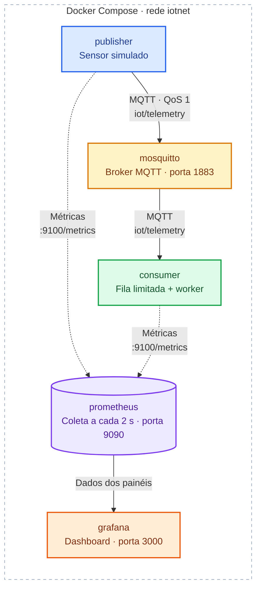
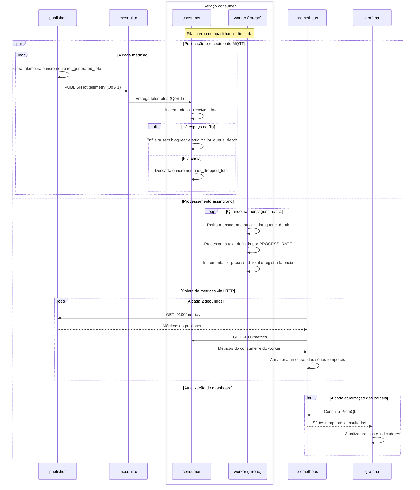
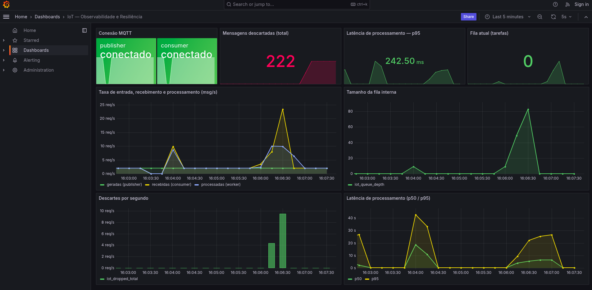

# Observabilidade e Resiliência em Sistemas IoT

Laboratório de observabilidade e resiliência para um fluxo de telemetria IoT via
MQTT. Material extra do [Módulo 3](../../README.md), apresentado na monitoria de
encerramento do curso; os slides de apoio estão em
[slides_monitoria.pdf](slides_monitoria.pdf) (também publicados em
[OPAIOT-2026](https://github.com/JunioCesarFerreira/OPAIOT-2026/tree/main/Extras/Apresenta%C3%A7%C3%A3o%20-%20Observabilidade%20e%20Resili%C3%AAncia%20em%20Sistemas%20IoT)).

Diferente do laboratório de [M2/Extras/Hands_On_HMAC_MQTT](../../../M2/Extras/Hands_On_HMAC_MQTT/),
aqui o broker não usa TLS nem autenticação: o foco é inteiramente observar o
sistema (logs, métricas) e fazer com que ele se recupere de duas falhas
comuns, não proteger o transporte.

## 1. Arquitetura



As setas mostram o sentido dos dados. As linhas tracejadas representam as
métricas que o Prometheus coleta via HTTP nos endpoints `/metrics` do
`publisher` e do `consumer`.

- **`publisher`**: gera medições simuladas de um sensor e publica em
  `iot/telemetry` (QoS 1), numa taxa configurável.
- **`mosquitto`**: broker MQTT (porta `1883`), sem TLS e com `allow_anonymous`.
- **`consumer`**: assina `iot/telemetry`. O *callback* MQTT (`on_message`) só
  empilha a mensagem numa fila interna limitada (`queue.Queue`); uma *thread*
  separada (o *worker*) retira dessa fila e processa numa taxa fixa. Se a fila
  estiver cheia, a mensagem é descartada e contabilizada — recebimento e
  processamento são eventos diferentes.
- **`prometheus`**: coleta `publisher:9100/metrics` e `consumer:9100/metrics`
  a cada 2 segundos.
- **`grafana`** (`http://localhost:3000`, `admin`/`admin`): abre já com o
  datasource do Prometheus e o dashboard "IoT — Observabilidade e Resiliência"
  provisionados, sem configuração manual.

Todos os serviços sobem no mesmo host via Docker Compose, na rede `iotnet`.

### Sequência de operação

O diagrama mostra o fluxo com os clientes MQTT conectados e o `consumer`
inscrito em `iot/telemetry`. O recebimento de mensagens, o processamento
pelo worker, a coleta de métricas e a atualização dos painéis acontecem de
forma independente.



## 2. Estrutura da pasta

```
compose.yaml              # mosquitto + publisher + consumer + prometheus + grafana
Makefile                  # make up / broker-down / broker-up / burst / logs / down
slides_monitoria.pdf      # slides de apoio da monitoria
print.png                 # captura do dashboard de observabilidade no Grafana
mosquitto/
  config/mosquitto.conf   # listener 1883, sem TLS, allow_anonymous
  data/, log/             # persistência e logs do Mosquitto (gerados, não versionados)
publisher/
  Dockerfile, requirements.txt
  publisher.py             # publica telemetria simulada; suporta um modo "rajada"
consumer/
  Dockerfile, requirements.txt
  consumer.py               # fila interna limitada + worker + métricas Prometheus
prometheus/
  prometheus.yml            # scrape de publisher:9100 e consumer:9100 a cada 2s
grafana/
  provisioning/datasources/ # datasource Prometheus (uid fixo: prometheus)
  provisioning/dashboards/  # dashboard "IoT — Observabilidade e Resiliência"
```

## 3. Como executar

Requer Docker e o plugin `docker compose`.

```bash
make up
```

Isso constrói as imagens do `publisher` e do `consumer` e sobe os cinco
serviços. O Mosquitto roda com o UID/GID do seu usuário (passados pelo
`Makefile`), para que `mosquitto/data` e `mosquitto/log` não fiquem com dono
diferente do seu usuário no host.

Abra:

- **Grafana**: http://localhost:3000 (dashboard "IoT — Observabilidade e
  Resiliência" já aberto; login `admin`/`admin`, ou sem login — acesso anônimo
  como visitante está habilitado).
- **Prometheus**: http://localhost:9090/targets, para conferir que `publisher`
  e `consumer` aparecem como `UP`.

O painel abaixo reúne o estado da conexão MQTT, as taxas de mensagens, a
ocupação da fila, os descartes e a latência de processamento. Esses gráficos
permitem acompanhar os efeitos da queda do broker e da sobrecarga do
consumidor nos experimentos das seções 4 e 5.



Outros comandos:

```bash
make logs           # acompanha publisher, consumer e mosquitto
make ps             # lista os containers e seu status
make down           # para os serviços
make clean           # para e remove containers e rede
```

## 4. Experimento 1 --- indisponibilidade do broker

**Pergunta:** o que acontece com a telemetria quando o broker MQTT deixa de
funcionar?

```bash
make broker-down     # docker compose stop mosquitto
# observe iot_mqtt_connected cair para 0 no Grafana, e os logs do publisher/consumer
make broker-up       # docker compose start mosquitto
# observe a reconexão automática e iot_mqtt_connected voltar a 1
```

O `publisher` e o `consumer` usam `loop_start()`/`reconnect_delay_set()` do
Paho MQTT: ao perder a conexão, tentam reconectar sozinhos, sem reiniciar o
container. O painel "Conexão MQTT" mostra essa transição em tempo real.

**Ponto conceitual:** reconexão não significa recuperação de todas as
mensagens. O `publisher` deste laboratório **não** guarda localmente as
medições geradas durante a queda (não há *outbox*) — elas se perdem. Mesmo
com QoS 1, a garantia de entrega "pelo menos uma vez" do MQTT só vale para
mensagens que chegaram a ser entregues ao broker; o que foi gerado enquanto
ele estava fora do ar nunca chegou lá.

## 5. Experimento 2 --- sobrecarga do consumidor

**Pergunta:** o que acontece quando chegam mais mensagens do que conseguimos
processar?

O `consumer` processa a ~10 mensagens/s (`PROCESS_RATE`, fila de 100
posições). O comando abaixo sobe um segundo publisher avulso (`device_id`
`burst-01`), publicando a ~30 mensagens/s por 8 segundos, **sem**
derrubar o publisher principal:

```bash
make burst
```

Acompanhe no Grafana (ou direto no endpoint `/metrics` do `consumer`):

1. `iot_queue_depth` sobe de forma praticamente linear enquanto a rajada dura.
2. Ao atingir 100, `iot_dropped_total` começa a crescer: mensagens novas são
   descartadas, pois a fila está cheia.
3. Quando a rajada termina, a fila volta a ser drenada até esvaziar.

Numa execução de teste local, a fila atingiu o limite de 100 por volta do
5º segundo da rajada, e cerca de 26 mensagens foram descartadas nos 3
segundos finais — os números variam de execução para execução, conforme o
agendamento do SO e a carga da máquina.

## 6. Métricas expostas

| Métrica | Tipo | Exposta por | O que mostra |
| --- | --- | --- | --- |
| `iot_mqtt_connected` | Gauge | publisher, consumer | estado da conexão MQTT (0 ou 1) |
| `iot_generated_total` | Counter | publisher | medições geradas |
| `iot_received_total` | Counter | consumer | mensagens recebidas (*callback* MQTT) |
| `iot_processed_total` | Counter | consumer | mensagens processadas pelo *worker* |
| `iot_queue_depth` | Gauge | consumer | tarefas aguardando na fila interna |
| `iot_dropped_total` | Counter | consumer | mensagens descartadas (fila cheia) |
| `iot_end_to_end_latency_seconds` | Histogram | consumer | latência ponta a ponta: da geração (timestamp do payload) ao fim do processamento |

## 7. Payload do sensor

```json
{
  "device": "esp32-sim-01",
  "seq": 1024,
  "temperature": 25.7,
  "timestamp": 1793200000.0
}
```

`seq` permite identificar lacunas na sequência (por exemplo, mensagens
geradas durante uma queda do broker e nunca entregues); `timestamp` é o
instante de geração, usado para calcular `iot_end_to_end_latency_seconds`.

## 8. Variáveis de ambiente

| Variável | Serviço | Padrão | Efeito |
| --- | --- | --- | --- |
| `PUBLISH_RATE` | publisher (principal) | `2` | mensagens/s publicadas |
| `QUEUE_SIZE` | consumer | `100` | posições da fila interna |
| `PROCESS_RATE` | consumer | `10` | mensagens/s que o *worker* processa |

Exemplo: `QUEUE_SIZE=20 make up` reduz a fila para deixar o descarte mais
visível em aula.

## 9. Limitações e exercícios opcionais

Este laboratório fica deliberadamente simples para caber em uma prática de
~15 minutos. Ficam como exercício:

- **Outbox persistente no publisher**: gravar localmente (arquivo ou SQLite)
  as medições geradas enquanto o broker está indisponível, e reenviá-las na
  reconexão.
- **Deduplicação por `seq`**: o `consumer` ainda não verifica se uma
  mensagem repetida (reenvio após reconexão, ou um publisher duplicado) já
  foi processada.
- **Comparar com e sem *load shedding***: um `consumer` que apenas processa
  tudo que chega (sem fila limitada) versus este, que descarta no limite —
  qual se comporta melhor sob rajada sustentada? Note que descartar no limite
  é *load shedding*, não *backpressure*: este laboratório não sinaliza o
  `publisher` para reduzir o envio, só protege o `consumer` do excesso.
- **Backpressure real**: hoje a fila cheia só descarta; um exercício seria
  fazer o `consumer` sinalizar o `publisher` (ou o próprio broker, via
  limites de QoS/fluxo) para reduzir ou pausar a publicação quando a fila
  se aproxima do limite.
